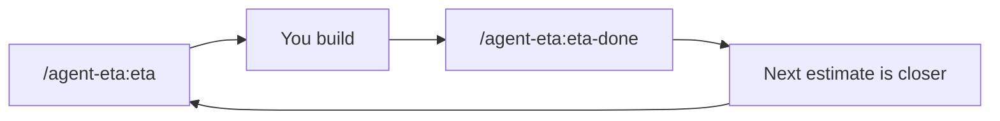
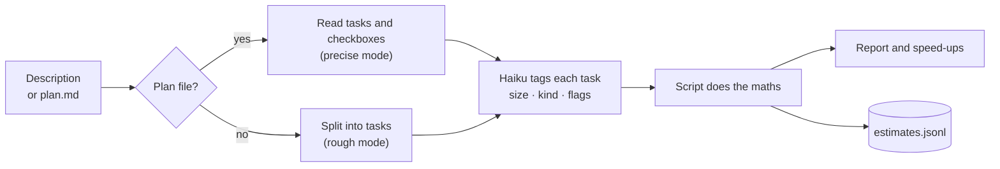
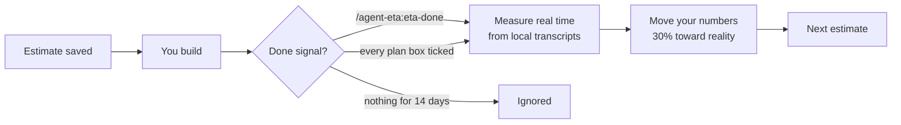

<div align="center">

# agent-eta

**How long will this *really* take with Claude Code?**

[](https://github.com/MuhammadTalhaMT/agent-eta/stargazers)
[](LICENSE)


</div>

---

> You ask Claude *"how long will this take?"*
> It says **"2–3 days."**
>
> The subagents write the code in under an hour.
> The build still takes all afternoon, because it spent most of it **waiting for you** to answer a question you didn't see.

Claude estimates like a human developer who types every line. With Claude Code, typing is nearly free. Your hours go somewhere else:

| Where the time really goes | Why a normal estimate misses it |
|---|---|
| ⏳ **Waiting on you** | Questions, approvals and manual tests stall the build until you reply |
| ✅ **Verification** | Builds, tests and review loops run after every task |
| 🔗 **Tasks in a chain** | Task 3 can't start until task 2 is done, however many agents you have |
| 🔁 **Rework** | Spec gaps and failed reviews send work back |

**agent-eta estimates the way the work actually unfolds.** It splits agent time from your time, gives a range and the single biggest risk, and tells you how to cut the total. Then it checks itself against your real sessions and gets more accurate over time.

---

## Quick start (2 minutes)

1. Add the marketplace: `/plugin marketplace add MuhammadTalhaMT/agent-eta`
2. Install: `/plugin install agent-eta@agent-eta`
3. Estimate something: `/agent-eta:eta add Stripe billing`

Requires Node.js 18+, which is already there wherever Claude Code runs.

---

## What you get

Real output for "add Stripe billing", using the shipped default numbers:

```
Total: 2h 25m – 4h 29m (wall clock)
  Agents working:   ~2h 11m   (you can walk away)
  You needed:       ~30 min   (5 questions, 2 approvals, 1 manual test)
  Waiting on you:   ~10 min   (Claude idle until you reply)
  Biggest risk:     Task 4 — Pricing page (+1h 08m if it goes badly)

Speed-ups (−35 min):
  • Tasks 2 & 4 are independent → run them in parallel, each in its own git worktree (−28 min)
  • 7 questions/approvals before the build → answer them in one go (−7 min)
  • Task 1 is mechanical → use a cheaper model (lower cost, ~same time)

Calibration: default numbers (3 more confirmed estimates until personal)
```

| Line | What to do with it |
|---|---|
| **Agents working** | Time you can walk away |
| **You needed / Waiting on you** | Time you must be at the keyboard. Block it in your calendar. |
| **Biggest risk** | The task most likely to blow the estimate. Watch this one. |
| **Speed-ups** | Each tip is priced by re-running the estimate with the change applied |
| **Calibration** | Whether the numbers are still the defaults or tuned to you yet |

---

## Commands

| Command | When to run it |
|---|---|
| `/agent-eta:eta add Stripe billing` | **Before** you build, from a plain description (rough mode) |
| `/agent-eta:eta docs/plans/billing.md` | **Before** you build, from a [superpowers](https://github.com/obra/superpowers) plan file (precise mode) |
| `/agent-eta:eta-done` | **After** you finish, so it can learn |
| `/agent-eta:eta-stats` | Any time, to see predicted vs actual for your last 10 estimates |



---

## How it works

Claude splits the work into tasks. A cheap Haiku subagent tags each task. **A plain script does all the maths, with no AI involved**, so the same tasks always give the same numbers.



Each task gets three tags:

| Tag | Values | What it changes |
|---|---|---|
| **size** | S · M · L | Base minutes for the task |
| **kind** | mechanical · integration · judgment | Base minutes, and how wide the range is |
| **flags** | manual_test · external_service · new_dependency | Time you're needed, extra risk, install time |

<details>
<summary><b>The exact maths</b></summary>

```
agent minutes  = base[kind][size] × workflow factor (+3 min if new_dependency)
your minutes   = phase gates (questions, spec and plan review) + manual tests
waiting        = number of gates × your typical reply delay
wall clock     = agent + your minutes + waiting

low   = wall × 0.85
high  = wall + √( Σ (agent_i × (spread_i − 1))² )
risk  = the task with the largest extra
```

- **Spread:** mechanical 1.3, integration 1.8, judgment 2.5, then × 1.5 if the task uses an external service.
- **Workflow factor:** 1.0 inline. 1.8 for subagent-driven work (implementer + spec review + quality review + fix loops).
- **Phase gates:** brainstorm, spec and plan are added when [superpowers](https://github.com/obra/superpowers) subagent-driven development is installed.

</details>

---

## How it learns



1. **It measures your real time** from Claude Code's own transcripts in `~/.claude/projects`. It splits agent time from your reply time and drops breaks over 30 minutes.
2. **It reads only two sessions:** the one where you ran `/agent-eta:eta` and the one where you ran `/agent-eta:eta-done`, plus their subagents. Other sessions in the same folder don't skew it.
3. **Each result moves your numbers 30% toward reality**, capped at ×0.5–×2 per update, so one odd build can't wreck them.
4. **Personal numbers switch on after 3 confirmed estimates.** Until then you get the defaults.
5. **It skips results it doesn't trust.** If the measured agent time is under 20% of the prediction, it assumes it missed the build and doesn't learn from it.

> **Tip:** if you `/clear` or open a new session to build, run `/agent-eta:eta-done` from the session where you built.

---

## What it costs

| Part | Tokens |
|---|---|
| `/agent-eta:eta` | About one normal Claude reply that reads a few files, plus one small Haiku call |
| `/agent-eta:eta-done`, `/agent-eta:eta-stats` | One short command |
| Measuring and learning | **0**. It's a local Node script. |

---

## Privacy

- Everything stays on your machine. Nothing is uploaded.
- Estimates and calibration live in the plugin data folder, or `~/.claude/agent-eta/`.
- Transcripts are read locally to get timings. **No message text is saved.**

---

## Limitations (v0.1)

- **The defaults come from one heavy user:** 670 implementer subagent runs and 2,636 replies, aggregates only. Expect your first 3 estimates to be off. That's what learning fixes.
- **A third session is invisible.** Work done outside the `/eta` and `/eta-done` sessions isn't counted, and that estimate is marked unconfirmed.
- **Plan-checkbox "done" uses the plan file's modified time.** A later rebase or checkout can stretch it. `/agent-eta:eta-done` is more accurate.
- **Tasks are modelled one after another** unless you take the parallel-worktree speed-up.

---

## Star history

[](https://star-history.com/#MuhammadTalhaMT/agent-eta&Date)

If agent-eta saved you from a "2–3 days" estimate, a ⭐ helps other people find it.

---

## Development

```
npm test                                              # 0 dependencies, node:test
node tools/seed-defaults.mjs                          # print default numbers from your own transcripts
node tools/consistency.mjs "add a dark mode toggle"   # 3 runs must agree within ±20%
```

Issues and PRs are welcome. The most useful report is your `/agent-eta:eta-stats` output after 5 or more builds.

## License

MIT
